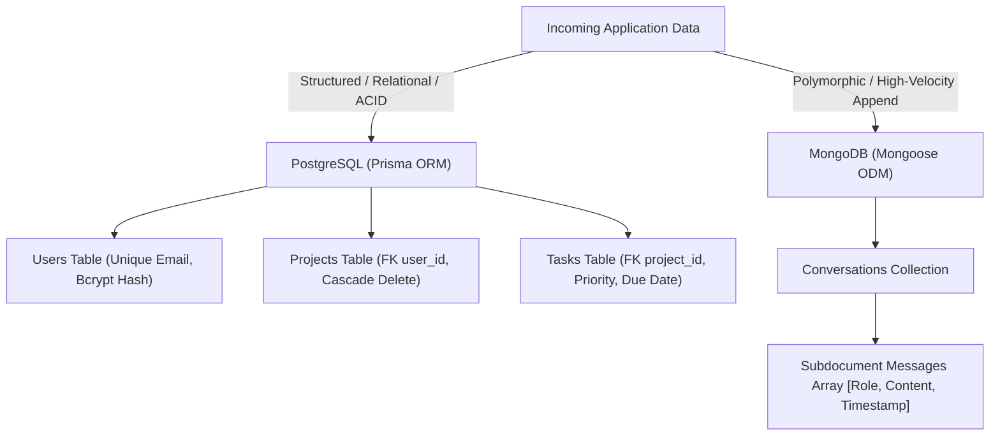
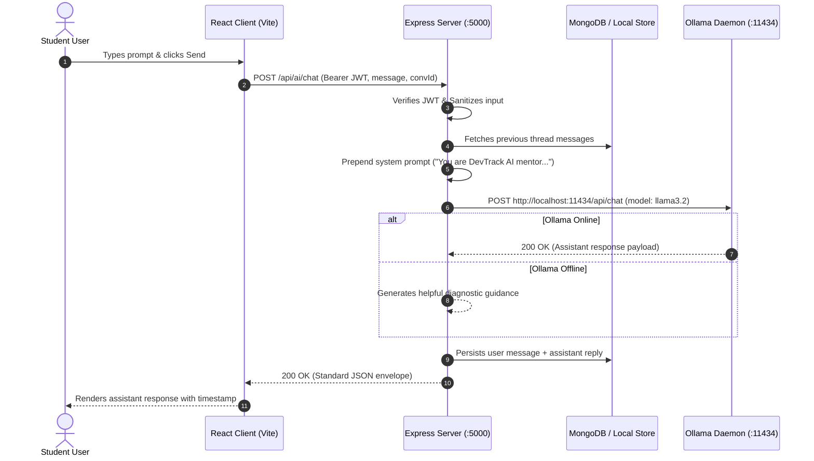
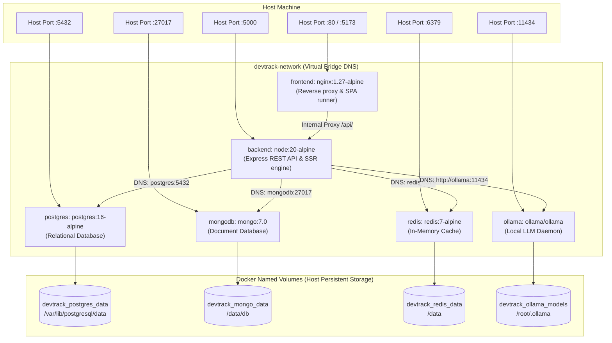
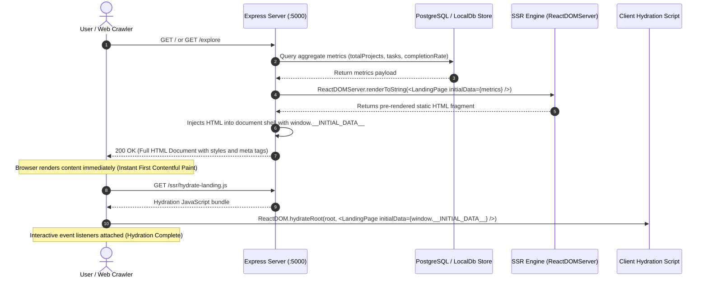
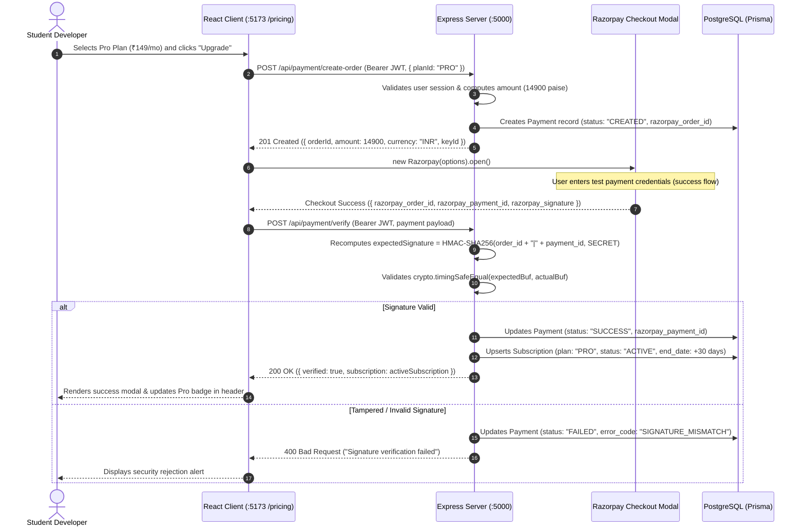

# DevTrack AI — High-Level Design (HLD) Document

**Document Title**: System High-Level Design Specification  
**Architecture Style**: Decoupled Monorepo with Polyglot Persistence & Local AI Subsystem  
**Version**: 1.0.0  

---

## 1. System Overview & Architecture Goals

DevTrack AI provides an integrated productivity and learning environment. Its architectural design prioritizes:
1. **Decoupled Modularity**: Independent React client and Express API within a unified monorepo.
2. **Data-Centric Polyglot Persistence**: Matching strict relational models (PostgreSQL) with flexible polymorphic document stores (MongoDB).
3. **Zero-Cloud Dependency**: Completely local, cost-free AI inference via Ollama.
4. **Fault Tolerance & Resilience**: Transparent fallback mechanisms allowing the application to run seamlessly regardless of whether Docker containers or local databases are running.

---

## 2. C4 Model Architectural Diagrams

### 2.1 Level 1: System Context Diagram
Shows how users interact with DevTrack AI and its internal/local boundaries.

```mermaid
flowchart TD
    User["Student Developer / Reviewer"]
    
    subgraph DevTrackPlatform["DevTrack AI Platform"]
        WebUI["React 18 SPA (Vite)"]
        APIServer["Express.js REST API"]
    end

    subgraph DataLayer["Storage & Caching Tier"]
        PostgresDB[("PostgreSQL Database\n(Users, Projects, Tasks)")]
        MongoDB[("MongoDB Database\n(Chat Threads & Messages)")]
        RedisCache[("Redis 7 In-Memory Cache\n(Sub-ms Key-Value Store)")]
        LocalStore[("Resilient Local Engine\n(devtrack-store.json)")]
    end

    subgraph LocalAI["Host Machine AI Daemon"]
        OllamaEngine["Ollama Runtime\n(http://localhost:11434)"]
        LLM["llama3.2 Model in VRAM"]
    end

    User -->|HTTPS/HTTP on :5173| WebUI
    User -->|Public GET /, /explore, /p/:id on :5000| APIServer
    WebUI -->|RESTful JSON Calls / Bearer JWT on :5000| APIServer
    APIServer -->|Prisma Client| PostgresDB
    APIServer -->|Mongoose ODM| MongoDB
    APIServer -->|Cache-Aside (node-redis)| RedisCache
    APIServer -.->|Automatic Fallback| LocalStore
    APIServer -->|Local HTTP Proxy| OllamaEngine
    APIServer -->|Test Order Creation & HMAC Verify| RazorpayGateway["Razorpay Test Gateway"]
    OllamaEngine --> LLM
```

### 2.2 Level 2: Container Diagram
Details internal containers and communication protocols.

```mermaid
flowchart LR
    subgraph Browser["Client Container"]
        SPA["Single Page Application\nReact 18 + Tailwind CSS"]
    end

    subgraph ServerContainer["Backend API Container"]
        Router["Express Router & Dispatcher"]
        Middleware["Security & Auth Middleware Stack"]
        Services["Domain Services Layer"]
        Router --> Middleware
        Middleware --> Services
    end

    subgraph DatabaseContainers["Database & Cache Subsystems"]
        PG["PostgreSQL Container\nport: 5432"]
        MG["MongoDB Container\nport: 27017"]
        RD["Redis 7 Container\nport: 6379"]
    end

    subgraph HostDaemons["Host Daemon"]
        OL["Ollama Engine\nport: 11434"]
    end

    SPA -->|HTTP / JSON (Port 5000)| Router
    Services -->|Prisma Connection Pool| PG
    Services -->|Mongoose Connection Pool| MG
    Services -->|TCP Socket (node-redis)| RD
    Services -->|HTTP Client (Fetch)| OL
```

---

## 3. Polyglot Storage Strategy

The platform implements a split storage tier:



### Why PostgreSQL for Projects & Tasks?
- **Referential Integrity**: Guarantees that a task cannot exist without a parent project (`onDelete: Cascade`).
- **Relational Aggregations**: Enables instant SQL calculations for project completion rates:
  $$\text{Completion Rate} = \left(\frac{\text{Completed Tasks}}{\text{Total Tasks}}\right) \times 100$$
- **Strict Typing**: Enforces enums on status and priorities.

### Why MongoDB for AI Conversations?
- **Variable Message Shape**: Prompts and assistant responses vary in token length, formatting, and subdocument count.
- **Atomic Document Appends**: Adding a message to a thread is an in-place `$push` operation without table locking.
- **Fast Lookups**: Compound indexing `{ userId: 1, updatedAt: -1 }` retrieves student chat history ordered chronologically.

---

## 4. Local AI Subsystem Architecture

The AI subsystem routes all inference through the Express backend to avoid hardcoding API URLs or exposing local ports to the browser:



---

## 5. Security Architecture

1. **Authentication Boundary**: Stateless JSON Web Tokens (JWT) signed with HMAC-SHA256 (`JWT_SECRET`). Tokens expire after 7 days.
2. **Credential Storage**: Passwords are salted with 10 rounds of `bcryptjs` before committing to storage. Raw passwords are never logged or stored.
3. **Access Control (Row-Level Security)**: Every project and task mutation explicitly enforces `WHERE id = resourceId AND user_id = req.user.id`.
4. **CORS Whitelist**: Access is restricted to `http://localhost:5173` and `http://127.0.0.1:5173`.
5. **Payload Boundaries**: Requests exceeding `1MB` are rejected with `413 Payload Too Large` to prevent memory exhaustion.

---

## 6. Infrastructure & Deployment Topology (Docker Multi-Service Architecture)

The entire full-stack application is containerized and orchestrated via [`docker-compose.yml`](file:///d:/Project/docker-compose.yml) across 6 interconnected containers on an isolated bridge network (`devtrack-network`):



- **Monorepo Workspaces**: Orchestrated via npm workspaces (`package.json`).
- **Database Provisioning**: Declarative multi-container setup via [`docker-compose.yml`](file:///d:/Project/docker-compose.yml) with health-checked dependency graphs (`condition: service_healthy`).
- **Automated CI/CD**: GitHub Actions workflow ([`.github/workflows/ci.yml`](file:///d:/Project/.github/workflows/ci.yml)) tests every pull request and push to `main` and `develop`.

---

## 7. Server-Side Rendering (SSR) Subsystem Architecture

DevTrack AI implements Server-Side Rendering for public, indexable pages while preserving the high-interactivity React SPA for authenticated users:



### SSR vs CSR Strategy & Boundary
- **Public Routes (`/`, `/explore`, `/p/:id`)**: Handled by Express SSR engine. Fully rendered on server, zero initial layout shift, instant SEO indexing.
- **Application Workspace (`/dashboard`, `/projects`, `/tasks`, `/ai`, `/learn`, `/pricing`, `/settings`)**: Handled by React 18 SPA (Vite) with Client-Side Rendering (CSR), instant routing transitions without full-page reloads.

---

## 8. Payment Gateway Subsystem Architecture (Razorpay Test Mode)

The payment subsystem handles subscription upgrades (`FREE` -> `PRO` -> `PREMIUM`) using Razorpay Test Mode with server-side HMAC-SHA256 signature verification:



---

## 9. Redis In-Memory Caching Subsystem Architecture

DevTrack AI integrates Redis 7 as an enterprise-grade caching tier adhering to the **Cache-Aside** design pattern:

```mermaid
sequenceDiagram
    autonumber
    actor Client as React Client / Student
    participant Express as Express Controller
    participant Cache as CacheService (node-redis)
    participant Redis as Redis 7 (In-Memory)
    participant DB as PostgreSQL (Prisma)

    rect rgb(24, 24, 27)
    note over Client, DB: 1. Read Flow (Cache-Aside with Sub-ms Hit)
    Client->>Express: GET /api/dashboard/stats (Bearer JWT)
    Express->>Cache: get("devtrack:user:{userId}:dashboard:stats")
    Cache->>Redis: GET key
    alt Cache Hit (Key exists & TTL valid)
        Redis-->>Cache: Serialized JSON string
        Cache-->>Express: Deserialized Stats Object
        Express-->>Client: 200 OK (X-Cache: HIT)
    else Cache Miss (Key absent or expired)
        Redis-->>Cache: null
        Cache-->>Express: null
        Express->>DB: Query User Projects & Tasks Aggregates
        DB-->>Express: Computed Stats
        Express->>Cache: set("devtrack:user:{userId}:dashboard:stats", stats, 300)
        Cache->>Redis: SETEX key 300 seconds JSON
        Express-->>Client: 200 OK (X-Cache: MISS)
    end
    end

    rect rgb(24, 24, 27)
    note over Client, DB: 2. Write Mutation Flow (Automated Cascade Invalidation)
    Client->>Express: PUT /api/tasks/:id (status: "COMPLETED")
    Express->>DB: UPDATE Task WHERE id = :id AND user_id = :userId
    DB-->>Express: Updated Task
    Express->>Cache: invalidateTaskCaches(userId)
    par Parallel Invalidation
        Cache->>Redis: DEL devtrack:user:{userId}:tasks:* (via SCAN)
        Cache->>Redis: DEL devtrack:user:{userId}:projects:* (rate changes)
        Cache->>Redis: DEL devtrack:user:{userId}:dashboard:stats
    end
    Express-->>Client: 200 OK (Updated Task Payload)
    end
```



### Key Design Pillars
1. **Multi-Tenant User Isolation**: Every cache key enforces the schema `devtrack:user:{userId}:<resource>:<identifier>`. No user can ever query or purge another user's cache keys.
2. **Deterministic Time-To-Live (TTL)**: Keys expire automatically (Dashboard = 300s, Projects = 300s, Tasks = 120s), eliminating zombie cache keys and memory bloat.
3. **Graceful Fallback**: If Redis crashes or is offline during local evaluation, `redis.js` switches transparently to an in-memory Map cache, preserving 100% API availability.

