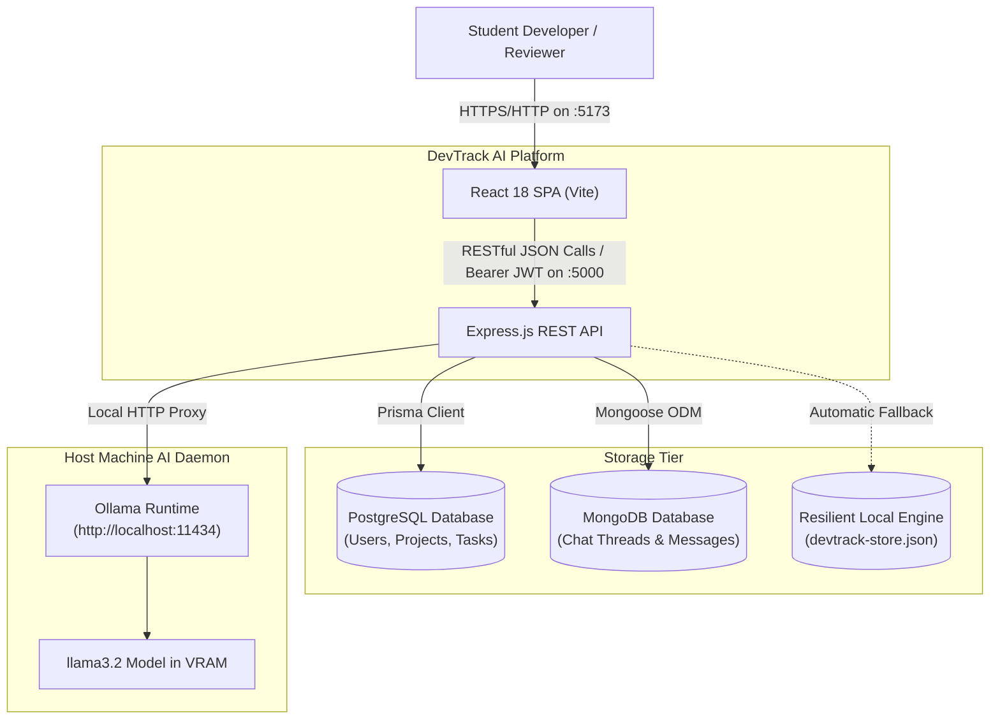
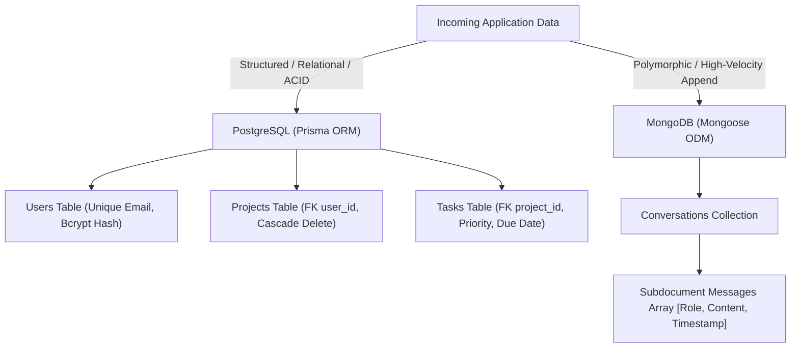
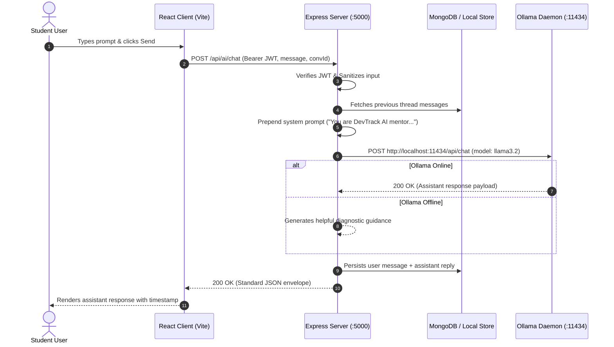

# DevTrack AI — High-Level Design (HLD) Document

**Document Title**: System High-Level Design Specification  
**Architecture Style**: Decoupled Monorepo with Polyglot Persistence & Local AI Subsystem  
**Version**: 1.0.0  

---

## 1. System Overview & Architecture Goals

DevTrack AI provides an integrated productivity and learning environment. Its architectural design prioritizes:
1. **Decoupled Modularity**: Independent React client and Express API within a unified monorepo.
2. **Data-Centric Polyglot Persistence**: Matching strict relational models (PostgreSQL) with flexible polymorphic document stores (MongoDB).
3. **Zero-Cloud Dependency**: Completely local, cost-free AI inference via Ollama.
4. **Fault Tolerance & Resilience**: Transparent fallback mechanisms allowing the application to run seamlessly regardless of whether Docker containers or local databases are running.

---

## 2. C4 Model Architectural Diagrams

### 2.1 Level 1: System Context Diagram
Shows how users interact with DevTrack AI and its internal/local boundaries.



### 2.2 Level 2: Container Diagram
Details internal containers and communication protocols.

```mermaid
flowchart LR
    subgraph Browser["Client Container"]
        SPA["Single Page Application\nReact 18 + Tailwind CSS"]
    end

    subgraph ServerContainer["Backend API Container"]
        Router["Express Router & Dispatcher"]
        Middleware["Security & Auth Middleware Stack"]
        Services["Domain Services Layer"]
        Router --> Middleware
        Middleware --> Services
    end

    subgraph DatabaseContainers["Database Subsystems"]
        PG["PostgreSQL Container\nport: 5432"]
        MG["MongoDB Container\nport: 27017"]
    end

    subgraph HostDaemons["Host Daemon"]
        OL["Ollama Engine\nport: 11434"]
    end

    SPA -->|HTTP / JSON (Port 5000)| Router
    Services -->|Prisma Connection Pool| PG
    Services -->|Mongoose Connection Pool| MG
    Services -->|HTTP Client (Fetch)| OL
```

---

## 3. Polyglot Storage Strategy

The platform implements a split storage tier:



### Why PostgreSQL for Projects & Tasks?
- **Referential Integrity**: Guarantees that a task cannot exist without a parent project (`onDelete: Cascade`).
- **Relational Aggregations**: Enables instant SQL calculations for project completion rates:
  $$\text{Completion Rate} = \left(\frac{\text{Completed Tasks}}{\text{Total Tasks}}\right) \times 100$$
- **Strict Typing**: Enforces enums on status and priorities.

### Why MongoDB for AI Conversations?
- **Variable Message Shape**: Prompts and assistant responses vary in token length, formatting, and subdocument count.
- **Atomic Document Appends**: Adding a message to a thread is an in-place `$push` operation without table locking.
- **Fast Lookups**: Compound indexing `{ userId: 1, updatedAt: -1 }` retrieves student chat history ordered chronologically.

---

## 4. Local AI Subsystem Architecture

The AI subsystem routes all inference through the Express backend to avoid hardcoding API URLs or exposing local ports to the browser:



---

## 5. Security Architecture

1. **Authentication Boundary**: Stateless JSON Web Tokens (JWT) signed with HMAC-SHA256 (`JWT_SECRET`). Tokens expire after 7 days.
2. **Credential Storage**: Passwords are salted with 10 rounds of `bcryptjs` before committing to storage. Raw passwords are never logged or stored.
3. **Access Control (Row-Level Security)**: Every project and task mutation explicitly enforces `WHERE id = resourceId AND user_id = req.user.id`.
4. **CORS Whitelist**: Access is restricted to `http://localhost:5173` and `http://127.0.0.1:5173`.
5. **Payload Boundaries**: Requests exceeding `1MB` are rejected with `413 Payload Too Large` to prevent memory exhaustion.

---

## 6. Infrastructure & Deployment Topology

- **Monorepo Workspaces**: Orchestrated via npm workspaces (`package.json`).
- **Database Provisioning**: Declarative multi-container setup via [`docker-compose.yml`](file:///d:/Project/docker-compose.yml).
- **Automated CI/CD**: GitHub Actions workflow ([`.github/workflows/ci.yml`](file:///d:/Project/.github/workflows/ci.yml)) tests every pull request and push to `main` and `develop`.
