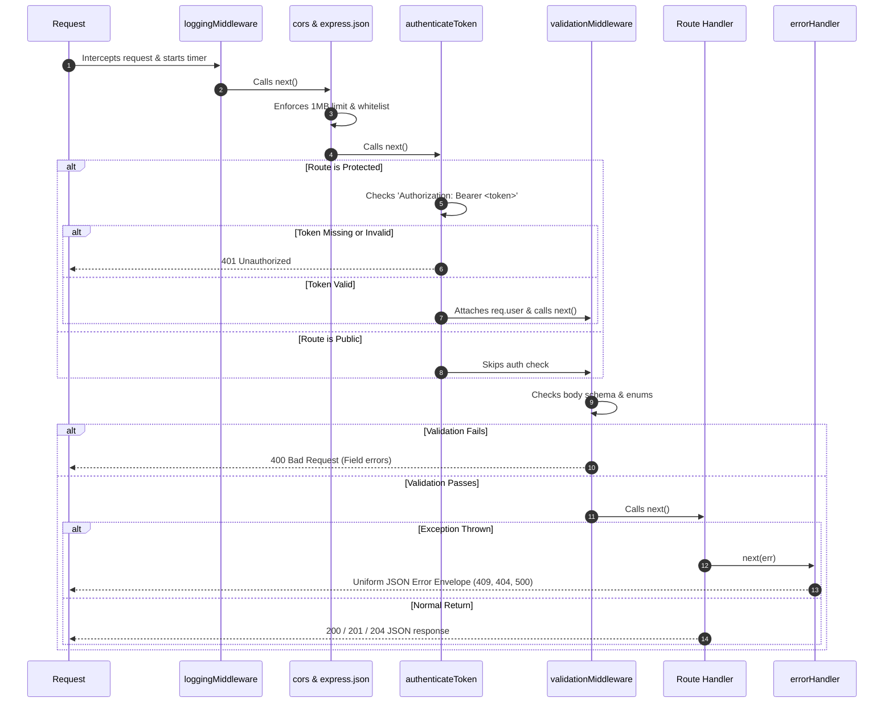
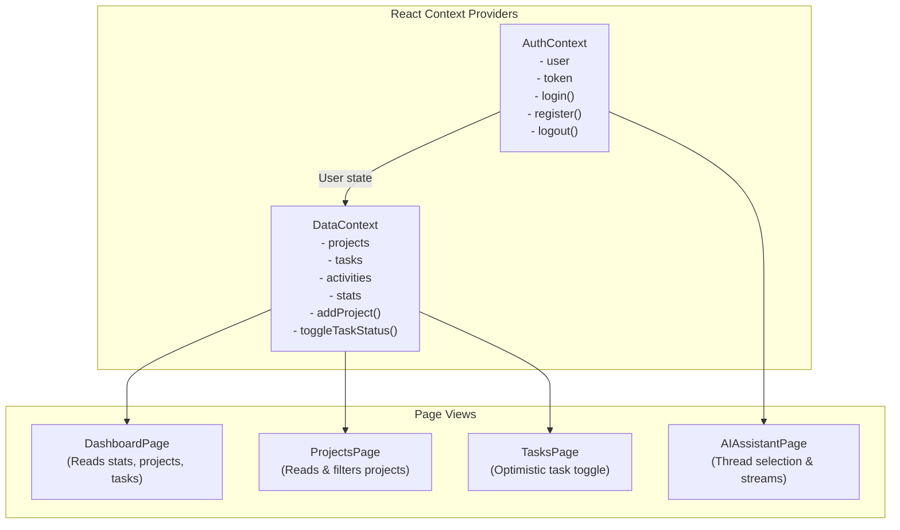

# DevTrack AI — Low-Level Design (LLD) Document

**Document Title**: Low-Level Software Design & Code Specification  
**Architecture Style**: Layered Controller-Service-Repository Pattern  
**Version**: 1.0.0  

---

## 1. Modular Class & Service Architecture

DevTrack AI follows a strict **Layered Controller-Service-Repository** pattern. Each layer has dedicated responsibilities:

```mermaid
classDiagram
    class AuthController {
        +register(req, res, next)
        +login(req, res, next)
        +getMe(req, res, next)
    }

    class ProjectController {
        +getProjects(req, res, next)
        +getProjectById(req, res, next)
        +createProject(req, res, next)
        +updateProject(req, res, next)
        +deleteProject(req, res, next)
    }

    class TaskController {
        +getTasks(req, res, next)
        +getTaskById(req, res, next)
        +createTask(req, res, next)
        +updateTask(req, res, next)
        +deleteTask(req, res, next)
    }

    class AuthService {
        +register(data) Promise~User, Token~
        +login(credentials) Promise~User, Token~
        +getMe(userId) Promise~User~
    }

    class ProjectService {
        +getProjects(userId) Promise~Project[]~
        +getProjectById(userId, projectId) Promise~Project~
        +createProject(userId, data) Promise~Project~
        +updateProject(userId, projectId, updates) Promise~Project~
        +deleteProject(userId, projectId) Promise~Boolean~
    }

    class TaskService {
        +getTasks(userId, filters) Promise~Task[]~
        +getTaskById(userId, taskId) Promise~Task~
        +createTask(userId, data) Promise~Task~
        +updateTask(userId, taskId, updates) Promise~Task~
        +deleteTask(userId, taskId) Promise~Boolean~
    }

    class AIService {
        +chat(userId, data) Promise~ChatResult~
        +getConversations(userId) Promise~Conversation[]~
        +getConversationById(userId, convId) Promise~Conversation~
        +deleteConversation(userId, convId) Promise~Boolean~
    }

    class PaymentController {
        +getPlans(req, res, next)
        +createOrder(req, res, next)
        +verifyPayment(req, res, next)
        +handleFailure(req, res, next)
        +getSubscription(req, res, next)
    }

    class PaymentService {
        +getPlans() Plan[]
        +createOrder(userId, planId) Promise~Order~
        +verifyPayment(userId, payload) Promise~VerifyResult~
        +handlePaymentFailure(userId, payload) Promise~Boolean~
        +getUserSubscription(userId) Promise~SubscriptionInfo~
    }

    class SSRRenderer {
        +renderLanding(req, res) Promise~HTML~
        +renderExplore(req, res) Promise~HTML~
        +renderProject(req, res) Promise~HTML~
        +buildHtmlShell(options) String
    }

    AuthController --> AuthService
    ProjectController --> ProjectService
    TaskController --> TaskService
    PaymentController --> PaymentService
```



---

## 2. Express Middleware Pipeline & Execution Flow

Every request executes through an ordered chain of middleware handlers:



---

## 3. Database Schema & Data Models

### 3.1 PostgreSQL Tables (Prisma Schema)

```sql
-- Users Table
CREATE TABLE "users" (
    "id" TEXT NOT NULL PRIMARY KEY,
    "name" TEXT NOT NULL,
    "email" TEXT NOT NULL UNIQUE,
    "password_hash" TEXT NOT NULL,
    "created_at" TIMESTAMP(3) NOT NULL DEFAULT CURRENT_TIMESTAMP,
    "updated_at" TIMESTAMP(3) NOT NULL
);

-- Projects Table
CREATE TABLE "projects" (
    "id" TEXT NOT NULL PRIMARY KEY,
    "user_id" TEXT NOT NULL REFERENCES "users"("id") ON DELETE CASCADE,
    "title" TEXT NOT NULL,
    "description" TEXT,
    "status" TEXT NOT NULL DEFAULT 'PLANNING',
    "created_at" TIMESTAMP(3) NOT NULL DEFAULT CURRENT_TIMESTAMP,
    "updated_at" TIMESTAMP(3) NOT NULL
);
CREATE INDEX "projects_user_id_idx" ON "projects"("user_id");

-- Tasks Table
CREATE TABLE "tasks" (
    "id" TEXT NOT NULL PRIMARY KEY,
    "project_id" TEXT NOT NULL REFERENCES "projects"("id") ON DELETE CASCADE,
    "title" TEXT NOT NULL,
    "description" TEXT,
    "status" TEXT NOT NULL DEFAULT 'PENDING',
    "priority" TEXT NOT NULL DEFAULT 'MEDIUM',
    "due_date" TEXT,
    "created_at" TIMESTAMP(3) NOT NULL DEFAULT CURRENT_TIMESTAMP,
    "updated_at" TIMESTAMP(3) NOT NULL
);
CREATE INDEX "tasks_project_id_idx" ON "tasks"("project_id");

-- Subscriptions Table
CREATE TABLE "subscriptions" (
    "id" TEXT NOT NULL PRIMARY KEY,
    "user_id" TEXT NOT NULL REFERENCES "users"("id") ON DELETE CASCADE,
    "plan" TEXT NOT NULL DEFAULT 'FREE',
    "status" TEXT NOT NULL DEFAULT 'ACTIVE',
    "start_date" TIMESTAMP(3) NOT NULL DEFAULT CURRENT_TIMESTAMP,
    "end_date" TIMESTAMP(3),
    "created_at" TIMESTAMP(3) NOT NULL DEFAULT CURRENT_TIMESTAMP,
    "updated_at" TIMESTAMP(3) NOT NULL
);
CREATE INDEX "subscriptions_user_id_idx" ON "subscriptions"("user_id");

-- Payments Table
CREATE TABLE "payments" (
    "id" TEXT NOT NULL PRIMARY KEY,
    "user_id" TEXT NOT NULL REFERENCES "users"("id") ON DELETE CASCADE,
    "razorpay_order_id" TEXT NOT NULL UNIQUE,
    "razorpay_payment_id" TEXT UNIQUE,
    "razorpay_signature" TEXT,
    "amount" INTEGER NOT NULL,
    "currency" TEXT NOT NULL DEFAULT 'INR',
    "plan" TEXT NOT NULL,
    "status" TEXT NOT NULL DEFAULT 'CREATED',
    "error_code" TEXT,
    "error_description" TEXT,
    "created_at" TIMESTAMP(3) NOT NULL DEFAULT CURRENT_TIMESTAMP,
    "updated_at" TIMESTAMP(3) NOT NULL
);
CREATE INDEX "payments_user_id_idx" ON "payments"("user_id");
CREATE INDEX "payments_razorpay_order_id_idx" ON "payments"("razorpay_order_id");
```

### 3.2 MongoDB Schema (`Conversation.js`)

```javascript
const messageSchema = new mongoose.Schema(
  {
    role: { type: String, required: true, enum: ['user', 'assistant', 'system'] },
    content: { type: String, required: true, trim: true },
    timestamp: { type: String, default: () => new Date().toISOString() },
  },
  { _id: true }
);

const conversationSchema = new mongoose.Schema(
  {
    userId: { type: String, required: true, index: true },
    title: { type: String, required: true, trim: true, default: 'New Conversation' },
    messages: [messageSchema],
  },
  { timestamps: true }
);

conversationSchema.index({ userId: 1, updatedAt: -1 });
```

---

## 4. Standardized API Response Contracts

All responses adhere to a uniform JSON envelope structure:

### Success Response (`200 OK` / `201 Created`)
```json
{
  "success": true,
  "statusCode": 200,
  "message": "Projects retrieved successfully.",
  "data": [
    {
      "id": "proj-1794021678",
      "userId": "usr-1794021600",
      "title": "Distributed KV Store in Go",
      "description": "Raft consensus protocol with LSM storage",
      "status": "IN_PROGRESS",
      "totalTasks": 4,
      "completedTasks": 3,
      "progress": 75,
      "createdAt": "2026-11-07T08:00:00.000Z",
      "updatedAt": "2026-11-07T08:30:00.000Z"
    }
  ]
}
```

### Validation Error Response (`400 Bad Request`)
```json
{
  "success": false,
  "statusCode": 400,
  "message": "User registration validation failed",
  "errors": {
    "email": "A valid email address is required.",
    "password": "Password must be at least 6 characters."
  }
}
```

### Conflict Error Response (`409 Conflict`)
```json
{
  "success": false,
  "statusCode": 409,
  "message": "A user with this email address already exists."
}
```

---

## 5. Frontend Reactive State Architecture



### Optimistic UI Updates
When a user toggles a task in the UI:
1. `DataContext.toggleTaskStatus(taskId)` immediately updates the task's state in React memory (`PENDING` $\leftrightarrow$ `COMPLETED`).
2. The UI immediately reflects the completion checkbox, strikethrough, and updated completion percentage score.
3. In the background, `api.tasks.update(taskId, { status })` is dispatched.
4. If the server request fails, the state automatically rolls back to the previous status and an error banner is presented.

---

## 6. Server-Side Rendering (SSR) Low-Level Mechanics

### 6.1 SSR Rendering Pipeline (`server/src/ssr/renderer.js`)
The renderer executes in Node.js ES Module mode using `react-dom/server`:
```javascript
// Data pre-fetching
const stats = await dashboardService.getStats('system');
const initialData = { stats, term: 'Academic Term 2026' };

// Component rendering to static string
const element = React.createElement(LandingPage, { initialData });
const contentHtml = ReactDOMServer.renderToString(element);

// Inject into HTML Shell with window.__INITIAL_DATA__
const html = buildHtmlShell({
  title: 'DevTrack AI — Student Productivity & Engineering OS',
  description: 'AI-powered productivity and learning management platform.',
  contentHtml,
  initialData,
  clientScript: '/ssr/hydrate-landing.js',
});
```

### 6.2 Browser Hydration Pipeline (`server/public/ssr/hydrate-landing.js`)
On initial HTML load, the browser reads `window.__INITIAL_DATA__` and hydrates without re-creating DOM nodes:
```javascript
const rootElement = document.getElementById('ssr-root');
const initialData = window.__INITIAL_DATA__ || {};

// Client hydration with ReactDOM.hydrateRoot
ReactDOM.hydrateRoot(rootElement, React.createElement(LandingPage, { initialData }));
```

### 6.3 Implementation File Mapping
- `server/src/ssr/renderer.js`: Controller functions (`renderLanding`, `renderExplore`, `renderProject`) and HTML template shell builder.
- `server/src/ssr/components/LandingPage.js`: Pre-rendered React landing component featuring hero metrics, feature breakdown, interactive FAQ, and CTA.
- `server/src/ssr/components/ExplorePage.js`: Public engineering project catalog pre-rendered from database records.
- `server/src/ssr/components/PublicProjectPage.js`: Individual project detail showcase with pre-rendered task lists and completion velocity.
- `server/public/ssr/hydrate-landing.js`: Client hydration bundle for the landing page.
- `server/public/ssr/hydrate-project.js`: Client hydration bundle for project showcase.

---

## 7. Payment Gateway (Razorpay) Cryptographic Implementation

### 7.1 Order Creation (`server/src/services/paymentService.js`)
```javascript
const razorpay_order_id = `order_test_${Date.now()}_${crypto.randomBytes(4).toString('hex')}`;
const amountInPaise = plan.amount; // ₹149 = 14900 paise

// Persist payment record with CREATED status
await prisma.payment.create({
  data: {
    user_id: userId,
    razorpay_order_id,
    amount: amountInPaise,
    currency: 'INR',
    plan: plan.id,
    status: 'CREATED',
  },
});
```

### 7.2 HMAC-SHA256 Signature Verification (`server/src/services/paymentService.js`)
```javascript
// 1. Calculate HMAC-SHA256 signature
const body = `${razorpay_order_id}|${razorpay_payment_id}`;
const expectedSignature = crypto
  .createHmac('sha256', env.RAZORPAY_KEY_SECRET)
  .update(body.toString())
  .digest('hex');

// 2. Constant-time buffer comparison to prevent timing side-channel attacks
let isAuthentic = false;
const expectedBuf = Buffer.from(expectedSignature, 'utf-8');
const actualBuf = Buffer.from(razorpay_signature, 'utf-8');
if (expectedBuf.length === actualBuf.length) {
  isAuthentic = crypto.timingSafeEqual(expectedBuf, actualBuf);
}

// 3. Update database state on verification
if (isAuthentic) {
  await prisma.payment.update({
    where: { razorpay_order_id },
    data: { razorpay_payment_id, razorpay_signature, status: 'SUCCESS' },
  });
  await prisma.subscription.upsert({ ... });
}
```

### 7.3 Frontend Pricing & Checkout Integration (`client/src/pages/PricingPage.jsx`)
- Injects `https://checkout.razorpay.com/v1/checkout.js` dynamically.
- Triggers `new window.Razorpay(options).open()`.
- Captures Razorpay success payload and invokes `POST /api/payment/verify`.
- Handles modal dismiss / cancellation events via `POST /api/payment/failure`.
