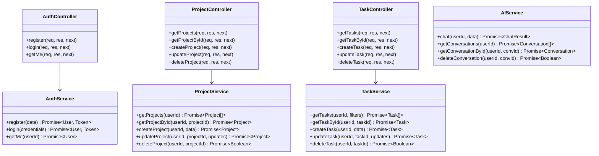
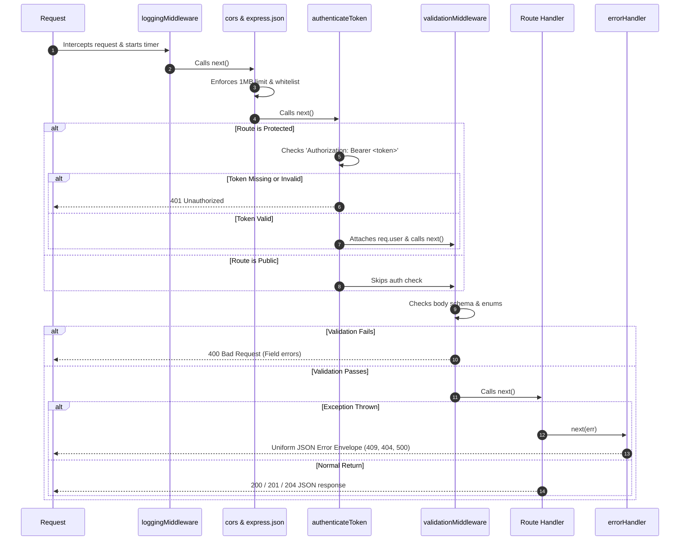
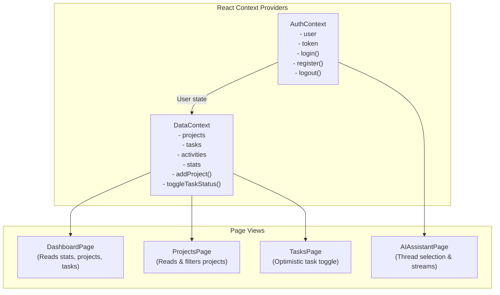

# DevTrack AI — Low-Level Design (LLD) Document

**Document Title**: Low-Level Software Design & Code Specification  
**Architecture Style**: Layered Controller-Service-Repository Pattern  
**Version**: 1.0.0  

---

## 1. Modular Class & Service Architecture

DevTrack AI follows a strict **Layered Controller-Service-Repository** pattern. Each layer has dedicated responsibilities:



---

## 2. Express Middleware Pipeline & Execution Flow

Every request executes through an ordered chain of middleware handlers:



---

## 3. Database Schema & Data Models

### 3.1 PostgreSQL Tables (Prisma Schema)

```sql
-- Users Table
CREATE TABLE "users" (
    "id" TEXT NOT NULL PRIMARY KEY,
    "name" TEXT NOT NULL,
    "email" TEXT NOT NULL UNIQUE,
    "password_hash" TEXT NOT NULL,
    "created_at" TIMESTAMP(3) NOT NULL DEFAULT CURRENT_TIMESTAMP,
    "updated_at" TIMESTAMP(3) NOT NULL
);

-- Projects Table
CREATE TABLE "projects" (
    "id" TEXT NOT NULL PRIMARY KEY,
    "user_id" TEXT NOT NULL REFERENCES "users"("id") ON DELETE CASCADE,
    "title" TEXT NOT NULL,
    "description" TEXT,
    "status" TEXT NOT NULL DEFAULT 'PLANNING',
    "created_at" TIMESTAMP(3) NOT NULL DEFAULT CURRENT_TIMESTAMP,
    "updated_at" TIMESTAMP(3) NOT NULL
);
CREATE INDEX "projects_user_id_idx" ON "projects"("user_id");

-- Tasks Table
CREATE TABLE "tasks" (
    "id" TEXT NOT NULL PRIMARY KEY,
    "project_id" TEXT NOT NULL REFERENCES "projects"("id") ON DELETE CASCADE,
    "title" TEXT NOT NULL,
    "description" TEXT,
    "status" TEXT NOT NULL DEFAULT 'PENDING',
    "priority" TEXT NOT NULL DEFAULT 'MEDIUM',
    "due_date" TEXT,
    "created_at" TIMESTAMP(3) NOT NULL DEFAULT CURRENT_TIMESTAMP,
    "updated_at" TIMESTAMP(3) NOT NULL
);
CREATE INDEX "tasks_project_id_idx" ON "tasks"("project_id");
```

### 3.2 MongoDB Schema (`Conversation.js`)

```javascript
const messageSchema = new mongoose.Schema(
  {
    role: { type: String, required: true, enum: ['user', 'assistant', 'system'] },
    content: { type: String, required: true, trim: true },
    timestamp: { type: String, default: () => new Date().toISOString() },
  },
  { _id: true }
);

const conversationSchema = new mongoose.Schema(
  {
    userId: { type: String, required: true, index: true },
    title: { type: String, required: true, trim: true, default: 'New Conversation' },
    messages: [messageSchema],
  },
  { timestamps: true }
);

conversationSchema.index({ userId: 1, updatedAt: -1 });
```

---

## 4. Standardized API Response Contracts

All responses adhere to a uniform JSON envelope structure:

### Success Response (`200 OK` / `201 Created`)
```json
{
  "success": true,
  "statusCode": 200,
  "message": "Projects retrieved successfully.",
  "data": [
    {
      "id": "proj-1794021678",
      "userId": "usr-1794021600",
      "title": "Distributed KV Store in Go",
      "description": "Raft consensus protocol with LSM storage",
      "status": "IN_PROGRESS",
      "totalTasks": 4,
      "completedTasks": 3,
      "progress": 75,
      "createdAt": "2026-11-07T08:00:00.000Z",
      "updatedAt": "2026-11-07T08:30:00.000Z"
    }
  ]
}
```

### Validation Error Response (`400 Bad Request`)
```json
{
  "success": false,
  "statusCode": 400,
  "message": "User registration validation failed",
  "errors": {
    "email": "A valid email address is required.",
    "password": "Password must be at least 6 characters."
  }
}
```

### Conflict Error Response (`409 Conflict`)
```json
{
  "success": false,
  "statusCode": 409,
  "message": "A user with this email address already exists."
}
```

---

## 5. Frontend Reactive State Architecture



### Optimistic UI Updates
When a user toggles a task in the UI:
1. `DataContext.toggleTaskStatus(taskId)` immediately updates the task's state in React memory (`PENDING` $\leftrightarrow$ `COMPLETED`).
2. The UI immediately reflects the completion checkbox, strikethrough, and updated completion percentage score.
3. In the background, `api.tasks.update(taskId, { status })` is dispatched.
4. If the server request fails, the state automatically rolls back to the previous status and an error banner is presented.
