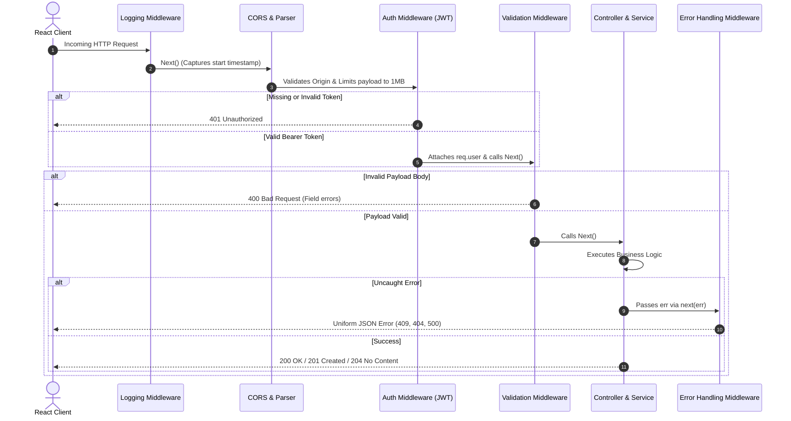

# DevTrack AI — Architecture & System Design Documentation

DevTrack AI is a full-stack, AI-powered productivity and learning management platform designed for software engineering students. This document describes the platform's architectural topology, design patterns, security model, and component hierarchy.

---

## 1. High-Level Architectural Overview

DevTrack AI utilizes a **Decoupled Client-Server Monorepo** paired with a **Polyglot Persistence Layer** and a **Local AI Inference Engine**:

```mermaid
flowchart TD
    subgraph Client["React 18 Frontend (Vite)"]
        UI["React UI (Tailwind CSS)"]
        Router["React Router DOM (v6)"]
        State["Context State (Auth & Data)"]
        API_Client["API Service Layer (Fetch)"]
        UI --> Router
        Router --> State
        State --> API_Client
    end

    subgraph Server["Node.js / Express Backend"]
        MW["Middleware Pipeline (Logging, CORS, Auth, Validation)"]
        Controllers["Controllers Layer"]
        Services["Services Layer (Business Logic)"]
        API_Client -->|HTTP / JSON (Bearer JWT)| MW
        MW --> Controllers
        Controllers --> Services
    end

    subgraph DataTier["Polyglot Persistence Layer"]
        PG[("PostgreSQL\n(Users, Projects, Tasks via Prisma)")]
        MG[("MongoDB\n(AI Chat Threads via Mongoose)")]
        Services -->|Prisma ORM| PG
        Services -->|Mongoose ODM| MG
    end

    subgraph LocalAI["Local AI Engine"]
        Ollama["Ollama Daemon\n(http://localhost:11434)"]
        Model["llama3.2 Local LLM"]
        Services -->|HTTP REST Proxy| Ollama
        Ollama --> Model
    end
```

---

## 2. Layered Responsibilities & Separation of Concerns

The codebase enforces strict boundaries between presentation, transport, business logic, and persistence:

| Layer | Directory | Primary Responsibility |
|---|---|---|
| **Presentation Layer** | `client/src/components/`, `client/src/pages/` | Renders UI, responds to user actions, manages component-level state with `useState` and `useEffect`. |
| **Client Service Layer** | `client/src/services/api.js` | Abstracts HTTP communication, injects `Bearer` authorization headers, and translates response status codes. |
| **Middleware Pipeline** | `server/src/middleware/` | Executes before controllers: validates payload structures, verifies JWT signatures, logs traffic, and catches exceptions. |
| **Controller Layer** | `server/src/controllers/` | Parses HTTP requests, coordinates with services, and crafts standardized HTTP responses using `apiResponse`. |
| **Service Layer** | `server/src/services/` | Houses core domain rules, relational ownership enforcement, hash generation, and proxy requests to Ollama. |
| **Persistence Layer** | `server/src/config/database.js`, `server/prisma/` | Connects to PostgreSQL via Prisma ORM and MongoDB via Mongoose, providing ACID guarantees and document scalability. |

---

## 3. Express Middleware Execution Pipeline

Every request flowing through the Express backend passes sequentially through four specialized middlewares before reaching the destination business handler:



---

## 4. Frontend Component & State Architecture

### Component Hierarchy
```
App.jsx (AuthProvider, DataProvider, BrowserRouter)
├── LoginPage.jsx / RegisterPage.jsx
└── AppLayout.jsx (Master Shell)
    ├── Sidebar.jsx (Navigation & AI Status Indicator)
    ├── Header.jsx (Search & Global "+ New" triggers)
    ├── Modal.jsx (ProjectForm & TaskForm)
    └── <Outlet />
        ├── DashboardPage.jsx (StatCards, QuickActions, RecentProjects, UpcomingTasks, Activity)
        ├── ProjectsPage.jsx (Filters, Search, Project Grid, Edit/Delete Modals)
        ├── ProjectDetailsPage.jsx (Deep-dive, Associated Tasks)
        ├── TasksPage.jsx (Full CRUD, Status & Priority Filters)
        ├── AIAssistantPage.jsx (Ollama Chat, Threads, Message History)
        ├── LearnConceptsPage.jsx (Interactive JS CS Labs & Quizzes)
        └── SettingsPage.jsx (User Profile, Telemetry, Handshakes)
```

### State Management Strategy
1. **`AuthContext`**: Handles session persistence in `localStorage`, JWT lifecycle, login, registration, and logout operations.
2. **`DataContext`**: Serves as the central reactive store for projects, tasks, and activity logs. Manages optimistic updates, triggers automated recalculation of dashboard KPIs, and handles real-time synchronization with the Express backend.

---

## 5. Security & Data Protection Architecture

1. **Authentication**: Stateless JSON Web Tokens (JWT) signed with HMAC-SHA256 using `JWT_SECRET`.
2. **Password Security**: Passwords are never stored in plaintext. They are salted with 10 rounds of `bcryptjs` before committing to the database.
3. **Resource Ownership Validation**: Every project and task mutation explicitly queries for `user_id == req.user.id`. A user cannot view, edit, or delete entities belonging to another user.
4. **CORS Hardening**: Access is strictly limited to authorized client origins (`http://localhost:5173`).
5. **Payload Limiting**: Express JSON parser enforces a strict `1MB` payload boundary to prevent memory exhaustion attacks.
6. **Data Leakage Prevention**: Centralized logging sanitizes sensitive headers and bodies, ensuring credentials and secret keys are never written to disk or console.
