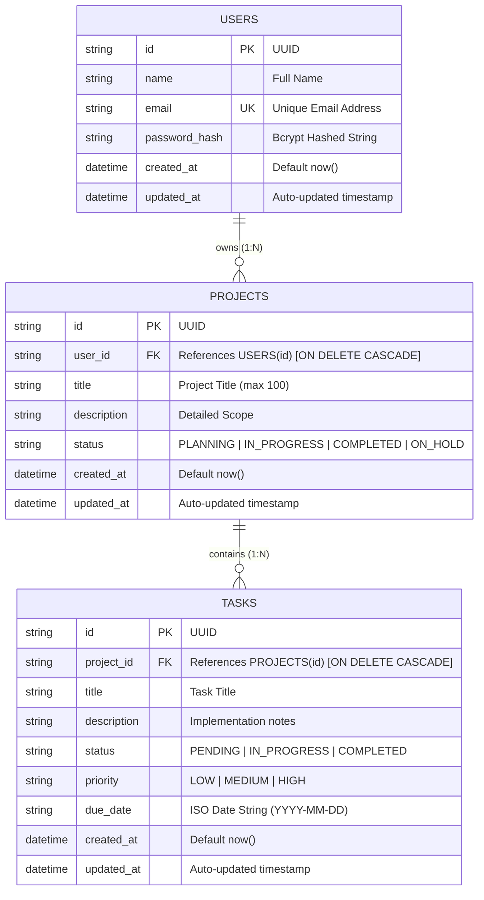

# DevTrack AI — Database Architecture Documentation

DevTrack AI implements a **Polyglot Persistence Architecture**, combining a relational database (**PostgreSQL** via **Prisma ORM**) and a document database (**MongoDB** via **Mongoose ODM**) to match data access patterns with the optimal database engine.

---

## 1. Polyglot Persistence Strategy: Why Both?

| Criterion | PostgreSQL + Prisma ORM | MongoDB + Mongoose ODM |
|---|---|---|
| **Data Domain** | Core Business Entities: Users, Projects, Tasks | Unstructured Polymorphic Entities: AI Chat Threads |
| **Data Shape** | Rigid tabular schemas with strict data types | Variable-length conversational message arrays |
| **Integrity Model** | ACID compliance, Foreign Keys, Referential Cascades | Eventual consistency, document atomicity |
| **Access Patterns** | Relational joins, aggregations (task completion %) | High-velocity sequential appends (chat tokens) |

---

## 2. PostgreSQL Relational Model (Prisma ORM)

### Entity Relationship Diagram (ERD)



### Constraints & Indexes
1. **`users.email`**: Marked with `@unique` constraint. Index type: B-Tree.
2. **`projects.user_id`**: Foreign Key referencing `users.id` with `onDelete: Cascade`. Indexed with `@@index([user_id])` for fast per-user lookups.
3. **`tasks.project_id`**: Foreign Key referencing `projects.id` with `onDelete: Cascade`. Indexed with `@@index([project_id])` for instant task joins.

### Prisma Schema (`server/prisma/schema.prisma`)
```prisma
model User {
  id            String    @id @default(uuid())
  name          String
  email         String    @unique
  password_hash String
  created_at    DateTime  @default(now())
  updated_at    DateTime  @updatedAt

  projects      Project[]

  @@map("users")
}

model Project {
  id          String   @id @default(uuid())
  user_id     String
  title       String
  description String?
  status      String   @default("PLANNING")
  created_at  DateTime @default(now())
  updated_at  DateTime @updatedAt

  user        User     @relation(fields: [user_id], references: [id], onDelete: Cascade)
  tasks       Task[]

  @@index([user_id])
  @@map("projects")
}

model Task {
  id          String   @id @default(uuid())
  project_id  String
  title       String
  description String?
  status      String   @default("PENDING")
  priority    String   @default("MEDIUM")
  due_date    String?
  created_at  DateTime @default(now())
  updated_at  DateTime @updatedAt

  project     Project  @relation(fields: [project_id], references: [id], onDelete: Cascade)

  @@index([project_id])
  @@map("tasks")
}
```

---

## 3. MongoDB Document Model (Mongoose ODM)

AI conversations require dynamic schemas capable of storing varied-length dialog exchanges between users and the local Ollama LLM.

### Collection: `conversations`

```json
{
  "_id": "673c1d4a8e239f1a0b5c98d2",
  "userId": "usr-1731056789-402",
  "title": "Event Loop Microtasks vs Timers",
  "messages": [
    {
      "_id": "673c1d4a8e239f1a0b5c98d3",
      "role": "user",
      "content": "Why does Promise.then execute before setTimeout(0)?",
      "timestamp": "2026-11-07T08:30:00.000Z"
    },
    {
      "_id": "673c1d4a8e239f1a0b5c98d4",
      "role": "assistant",
      "content": "The JavaScript event loop prioritizes the Microtask queue over the Macrotask timers queue...",
      "timestamp": "2026-11-07T08:30:01.200Z"
    }
  ],
  "createdAt": "2026-11-07T08:30:00.000Z",
  "updatedAt": "2026-11-07T08:30:01.200Z"
}
```

### Mongoose Indexing
```javascript
conversationSchema.index({ userId: 1, updatedAt: -1 });
```
This compound index enables sub-millisecond retrieval of a student's conversation threads sorted by recency.

---

## 4. Docker Compose Database Setup

Both PostgreSQL and MongoDB can be provisioned in isolated containers:

```bash
# Start both database services
docker compose up -d

# Verify healthy status
docker compose ps
```

Once running, run the Prisma migration command:
```bash
cd server
npm run prisma:push
```
